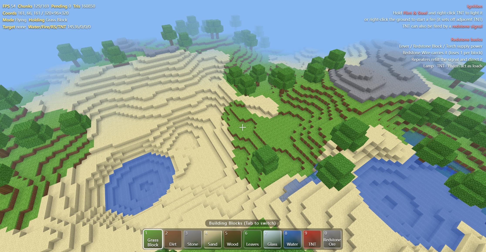

# Your World · Web Edition

A blocky sandbox game that runs in a browser tab — **one single `.html` file, zero dependencies, zero build step, zero network requests**. Everything (terrain, textures, water, redstone, explosions) is generated at runtime on top of raw WebGL.

Open `yourworld_en.html` in any modern browser and click to start. That's the whole install.



---

## Highlights

- **Single file, no libraries.** Hand-written WebGL: custom shaders, vertex buffers, distance-sorted chunk streaming, no Three.js.
- **320 × 96 × 320 world** (≈9.8 million blocks) split into 16×16 chunks, generated on demand as you walk — memory stays flat however far you travel.
- **Procedural terrain.** Value-noise fbm builds hills, ridges, sandy biomes and rocky peaks; 14 bowl-shaped lakes with individually levelled surfaces; scattered trees; underground redstone ore veins.
- **Procedural texture atlas.** Every block texture is painted pixel-by-pixel onto a `<canvas>` at load time (4×8 grid of 16×16 tiles) — grass, wood rings, glass, TNT, redstone parts, animated-ready water, fire gradient.
- **Ambient occlusion + face culling**, fog, underwater fog, and a translucent pass so glass and water blend correctly.
- **Chunk streaming with a per-frame time budget** (5 ms generate / 6 ms build) instead of a fixed chunk count, so frame rate stays smooth even when a chunk is expensive.

## Redstone

A real, tick-based redstone simulation — not just decorative blocks:

| Component | Behaviour |
|---|---|
| Lever / Redstone Block / Torch | Power sources (14 into adjacent wire) |
| Redstone Wire | BFS signal propagation, −1 power per block |
| Repeater | Refills the signal to full and directs it; right-click to cycle the delay |
| Redstone Lamp | Load — lights up when powered |
| Piston | Extends an arm and pushes blocks |
| TNT | Explodes when powered, or when lit |

Only wire whose power actually changed triggers a chunk rebuild, so a busy circuit doesn't thrash the mesher.

## Fire & Flint and Steel

Hold **Flint & Steel** (hotbar page 2, slot 1) and right-click TNT to light a 2.5 s fuse, or right-click the ground to start a fire. Fire sits on solid blocks, flickers, dies out after ~5 s, goes out instantly in water, and ignites adjacent TNT.

## Water

A gradual, Minecraft-flavoured fluid sim rather than instant flooding:

- Source blocks stay pinned at full level and only *supply*.
- Each tick is one synchronous relaxation — a cell can only accept `level − 1` from a neighbour, so water creeps outwards one block at a time.
- Cut off from its source, water loses one level per tick until it dries up.
- Falling water only travels down, so a waterfall is a column, not a cone.
- Only water near the player is simulated; distant water is frozen (cheaper, and it stops water leaking into un-generated terrain).

## Controls

| Key | Action |
|---|---|
| `W` `A` `S` `D` | Move |
| `Space` | Jump (hold to rise in water) |
| `Shift` | Sprint |
| Mouse | Look |
| Left click | Break block |
| Right click | Place block / flip lever / set repeater delay |
| `1`–`8`, wheel | Select block |
| `Tab` | Switch hotbar page |
| `F` | Toggle flight |
| `H` | Help overlay |
| `Esc` | Release the mouse |

## Performance notes

- Chunks inside a radius of 6 are meshed; past radius 9 their GPU buffers are released.
- Terrain generation looks 2 blocks past each chunk border so trees and lake shores survive chunk seams.
- The tree test screens 98.8% of columns out with a single cheap hash before ever computing the height field.
- Face culling and AO are served from a per-chunk local cache with a 1-block border, turning neighbour queries into local array reads.

## Running it

```bash
# no build, no server required
open yourworld_en.html          # macOS
xdg-open yourworld_en.html      # Linux
# or just double-click the file
```

A local static server works too if your browser is picky about file:// pointer lock:

```bash
python3 -m http.server 8000
```

Requires a browser with WebGL and Pointer Lock (any current Chrome, Edge, Firefox or Safari).

## Known limits

- No world saving — closing the tab discards your builds.
- No inventory, crafting or mobs — it is a building and redstone playground, not a full survival mode.
- The world seed is fixed (`20261021`), so everyone gets the same terrain. Change `SEED` near the top of the script for a different world.

## License

MIT.
